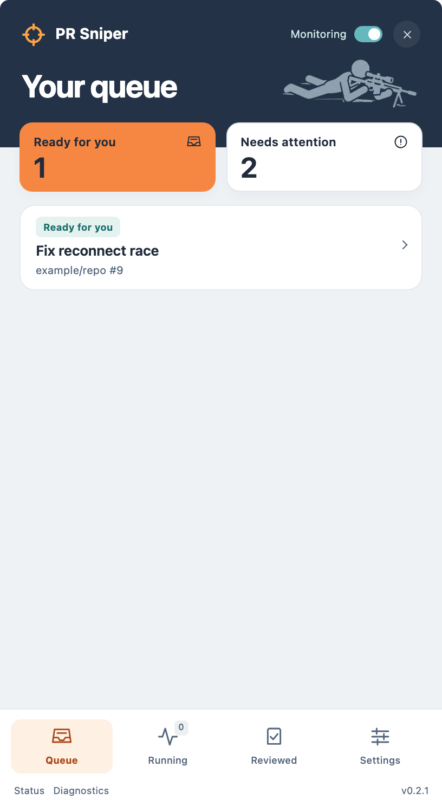
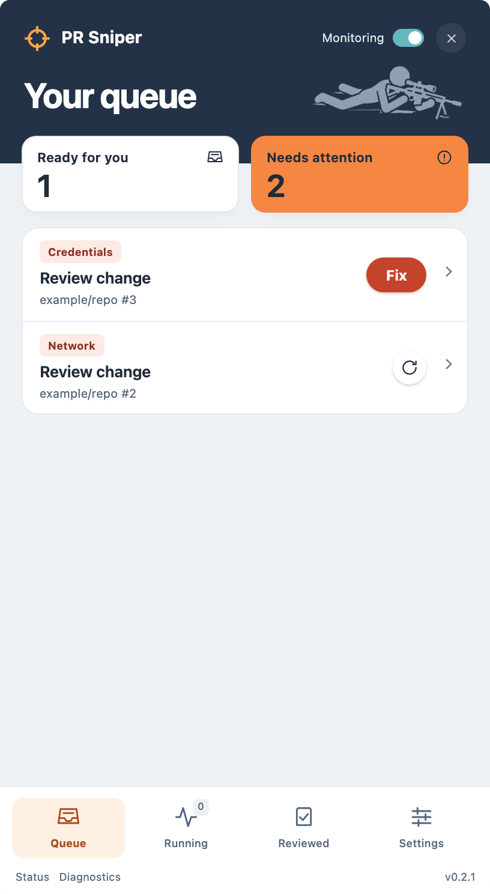
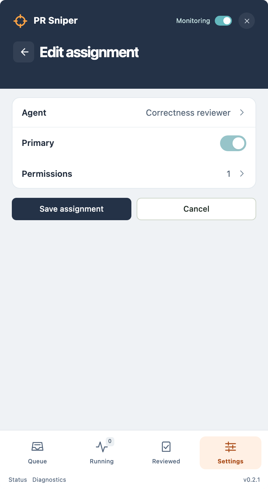

# PR Sniper

**Review bot with manners. You keep the last word.**

Menu-bar macOS app. Watches your GitHub repos. Copilot agents review each pull request revision once, reply to new comments, and leave the final call to you. It prepares work. It never merges without an explicit grant.

## Why

PR queues grow. Agents read diffs fast and never get bored. Humans should read PRs agents already vetted. PR Sniper puts those in one list: **Ready for you**.

<table>
  <tr>
    <td></td>
    <td></td>
    <td></td>
  </tr>
</table>

| More                                                |                                           |                                                 |
| --------------------------------------------------- | ----------------------------------------- | ----------------------------------------------- |
| [Running](docs/screenshots/running.png)             | [Reviewed](docs/screenshots/reviewed.png) | [Permissions](docs/screenshots/permissions.png) |
| [Failed detail](docs/screenshots/detail-failed.png) | [Agent](docs/screenshots/agent.png)       | [Repository](docs/screenshots/repository.png)   |
| [Settings](docs/screenshots/settings.png)           |                                           |                                                 |

## How it works

1. Poll enabled repos on one global schedule.
2. Admission decides which PRs enter: **All** or ordered **Filtered** rules (assigned, mentioned, include/exclude users, include/exclude paths). First enabled matching rule wins.
3. One review per head SHA. New push = new revision = another review. Same revision: agent only replies to new comments.
4. Agents see description, changed files and all comments. They act only with explicit permissions: **Publish Comment**, **Reply Comment**, **Approve**, **& Merge**. New assignments start with every grant off.
5. Results land in **Queue**: **Ready for you** or **Needs attention**. Transient failures retry with backoff, 3 attempts, then park. Credential, permission and permanent failures park at once. Parked failures auto-resume (cooldowns 30m to 8h, five cycles; credentials on reconnect). Rows offer **Fix** (credentials, goes to Accounts) or **Retry**.
6. Merged or closed PRs move to **Reviewed**. Results stay local.

## Install

Apple Silicon, macOS 13.5+.

```sh
brew install --cask jdylanmc/pr-sniper/pr-sniper
```

Or download the signed, notarized ZIP from [Releases](https://github.com/jdylanmc/pr-sniper/releases). Quit the app before `brew upgrade --cask pr-sniper`. Homebrew owns updates; no in-app updater. Details: [docs/releases.md](docs/releases.md).

## Quick start

1. Open **Settings > Accounts**. Connect a GitHub account (**Git Repository**) and a Copilot account (**AI Tooling**). Browser sign-in, no pasted tokens.
2. Add a repository. Pick its GitHub account.
3. Pick admission: **All** or **Filtered**.
4. Create an Agent (Copilot account + model). Assign it to the repo. Set **Permissions**. Mark one assignment **Primary** to let it reply.
5. Enable the repo. Watch **Queue**.

## Safety model

- Local results. Nothing posts unless a permission says so.
- One review per revision. Publication revalidates the head SHA before and after.
- GitHub and Copilot identities are separate. Connecting one never connects the other.
- Approve and merge are opt-in, primary-agent-only, fail closed.
- Agents get three host-owned review tools. That is a boundary, not a sandbox.

## Docs

- [docs/README.md](docs/README.md): index of references and specs.
- [CONTEXT.md](CONTEXT.md): domain glossary.
- [docs/adr/](docs/adr/): architecture decisions.
- [AGENTS.md](AGENTS.md): build, test, UI rules.

## Develop

```sh
npm ci
npm run dev:signed   # Tauri dev, stable signing identity
npm run lint
npm test
npm run test:settings
```

Requires Node 24.20+ and the Rust toolchain pinned in `rust-toolchain.toml`. Everything else is in [AGENTS.md](AGENTS.md).

## Contributing

Read [AGENTS.md](AGENTS.md). File issues and PRs at [jdylanmc/pr-sniper](https://github.com/jdylanmc/pr-sniper/issues).

## License

[MIT](LICENSE).
